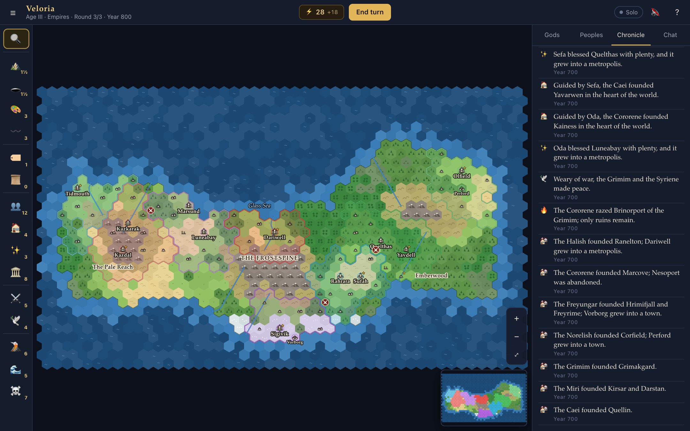

# CTB World

A multiplayer world-building game for the browser. You and your friends are young gods sharing one world: over three Ages you raise mountains, carve rivers, name the seas, awaken peoples and raise wonders — and between your turns those peoples grow, spread, trade and go to war on their own. Everything that happens is written into the world's Chronicle.

**Play now:** <https://ctbot000.github.io/ctb-world/>



1. Pick a name, a colour and a domain, then press **Create a world**.
2. Send your friends the invite link (or the five-letter world code). They join from their own browsers — no accounts, no installs.
3. The host presses **Begin the world**. Everyone shapes the same map at the same time; press **End turn** when you are done, and a century passes.

You can also **Play alone**, and nothing leaves your browser.

## The game

**Three Ages.** Each round every god gets fresh power (unspent power carries over, up to 40). A round ends when every god has pressed End turn, or when the host's timer runs out.

| Age | Power | What it is about |
| --- | ---: | --- |
| I · Shaping | +20 | The world is clay. Raise lands, carve rivers, name the seas. Peoples cannot wake yet. |
| II · Awakening | +12 | Peoples wake and spread. Found settlements, raise wonders; shaping costs more. |
| III · Empires | +12 | Realms collide. Shaping is costly now; wonders, war and wrath are cheap. |

**Deeds.** Raise and lower land (sea → land → hills → mountains), paint biomes, carve rivers, name places, inscribe legends, awaken peoples, found settlements, bless them, raise one of eight unique wonders, incite war or broker peace — and, if the host allows it, divine wrath: eruptions, deluges and plagues.

**Domains.** Every god has one, and it makes some deeds cheaper: Stone (land), Tides (rivers and floods), Wilds (biomes and blessings), Hearth (peoples and wonders), Storms (war and wrath) or Stars (extra power, free names, legends that count).

**Peoples live on their own.** Six kinds — Plainsfolk, Seafarers, Highlanders, Sylvan, Nomads and Frostkin — each thriving on different land. A settlement grows from hamlet to metropolis if the land around it can feed it; big settlements found new ones; neighbours trade, feud, besiege, capture and raze. Shape the land well and your peoples flourish.

**Legacy.** When the third Age ends the gods are ranked by legacy: +1 for every settlement size their peoples hold, +3 per living people, +5 per wonder, +1 per named place. A **Sandbox** mode drops the scoring and the Ages: unlimited power, no end.

The in-game **How to play** has the full tables, generated from the same data the engine uses.

## Features

- A procedurally generated hex world — continents, pangaea, archipelago or an empty primordial sea — with biomes from latitude and moisture and rivers that run downhill.
- Real-time multiplayer for up to eight gods plus spectators: everyone's deeds appear on everyone's map at once, with live cursors and chat.
- A simulation between rounds: growth, expansion, territory, trade, wars, captures, abandonment and extinction.
- The Chronicle: a readable history of the world, filterable, clickable (it shows you where things happened) and downloadable as Markdown.
- Save the world to a file and load it again later, export the map as a PNG.
- Works on phones and tablets (drag, pinch, tap), with keyboard shortcuts on desktop.
- No build step and no runtime dependencies: vanilla JavaScript modules, Canvas 2D, and a synthesised sound effect or two.

## Two ways to play together

**Peer to peer (the hosted page).** The browser that creates a world *is* the host: it runs the authoritative game and the other players connect to it directly over WebRTC data channels. The free [PeerJS](https://peerjs.com/) server only introduces the browsers to each other; when a direct connection is blocked, traffic is relayed through the TURN servers in PeerJS's default configuration. The host should keep the tab open. If the host reloads or loses the connection, the world is saved in their browser, resumes under the same code, and everyone reconnects as the same god.

To use your own signaling server, run a [PeerServer](https://github.com/peers/peerjs-server) (`npx peer --port 9000`) and open the game with `?signal=http://localhost:9000/`. Invite links carry the setting along.

**Dedicated server.** `npm start` serves the game and hosts worlds itself, over WebSocket, so nobody's browser has to stay open. The page notices the server and switches to it automatically. It uses only Node's built-ins — the WebSocket protocol is implemented in [`server/websocket.js`](server/websocket.js) — so it runs anywhere Node 22+ runs. Empty worlds are kept for two hours (lobbies for ten minutes) so players can come back.

```bash
npm install
```

```bash
npm start
```

Then open <http://localhost:8723/>. To play with others on your network, `npm start -- --host 0.0.0.0` prints the addresses to share; `PORT` and `HOST` work too.

## How it works

```
 player's browser                          host (a browser, or server/server.js)
┌──────────────────────┐   join, deeds,   ┌─────────────────────────────────────┐
│ Store: world replica │ ───────────────► │ Room: players, tokens, timer, chat  │
│ Renderer (Canvas 2D) │                  │ Game: the authoritative world       │
│ GameUI, MapInput     │ ◄─────────────── │   deeds → validation → state change │
└──────────────────────┘  welcome, patch, │   end of round → simulation         │
                          chat, cursors   └─────────────────────────────────────┘
```

- `public/js/shared/` is the engine, shared by the browser and the server: hex geometry, world generation, the rules as data, the game itself and the room protocol. It has no DOM dependencies.
- Every change to the world goes through the engine, which records what it touched. After each message the room flushes those records into a *patch* and broadcasts it; clients apply patches to their replica. A new or returning player gets a full snapshot.
- The transport is interchangeable: an in-page loopback (solo, and the host's own player), WebRTC data channels (peer to peer, with messages chunked to fit the channel), or WebSocket (dedicated server).
- Players reconnect with a token, or by name if they come back on another device. Players who reconnect keep their god, their peoples and their power.

## Tests

```bash
npm test
```

- Engine: hex geometry, deterministic world generation, every deed and its costs, the three Ages, the simulation, saving and loading — and whole games played by random bots, checking the invariants after every step and that a replica fed only patches ends up identical to the host.
- Room: joining, reconnecting, the round timer, readiness, the lobby grace period, kicking, rate limiting, loading saved worlds, and message chunking.
- Server: static files and path traversal, the WebSocket handshake and framing (fragmentation, masking, frames that arrive with the handshake), and real WebSocket clients playing a round together.
- End to end in headless Chrome: two players on the dedicated server, two players peer to peer through a local PeerServer, a host that reloads mid-game while its guest reconnects, and a solo game played to the final reckoning. Set `CHROME_PATH` if Chrome is not installed in a standard location; without Chrome these are skipped.

## Project layout

```
public/                  the whole site; no build step
  index.html, css/, favicon.svg
  js/main.js             title screen, choosing a connection, sessions, autosave
  js/game-ui.js          toolbar, top bar, lobby, sidebar, inspector, dialogs
  js/render.js           the map (and minimap) on a canvas
  js/input.js            mouse, touch and keyboard on the map
  js/net.js              solo / peer-to-peer host, peer-to-peer guest, WebSocket links
  js/store.js            the client's replica of the world
  js/shared/             the engine: hex.js, rng.js, rules.js, names.js,
                         worldgen.js, game.js, room.js, codes.js
  vendor/peerjs.min.js   PeerJS (npm run vendor)
server/                  the dedicated server and its WebSocket implementation
test/                    node:test suites
```

`public/` is deployed to GitHub Pages by the CI workflow after the tests pass.

## Privacy

- No accounts, analytics or cookies. Your name, colour and domain, your reconnect tokens and any world you host are kept in your browser's `localStorage`.
- In peer-to-peer play the signaling server sees peer ids and connection setup data (which include IP addresses), never the game. Anyone with a world's code can join it while it runs.

## License

[MIT](LICENSE). Includes [PeerJS](https://github.com/peers/peerjs) (MIT).
